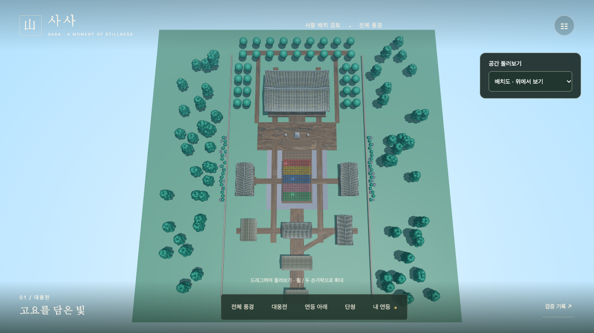
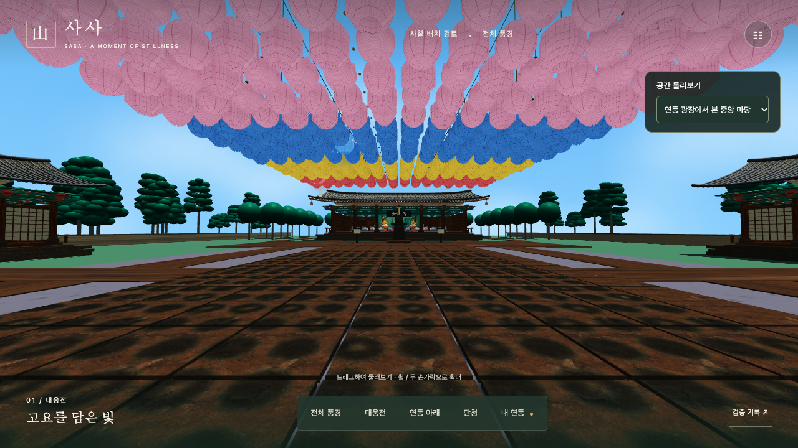
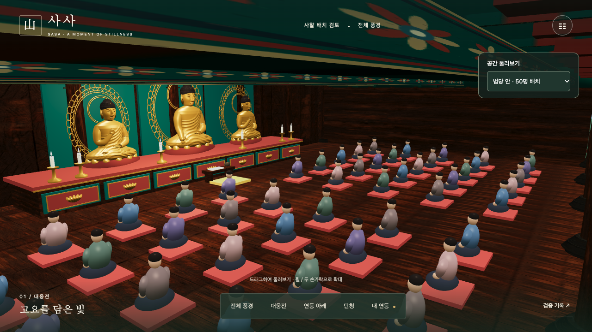
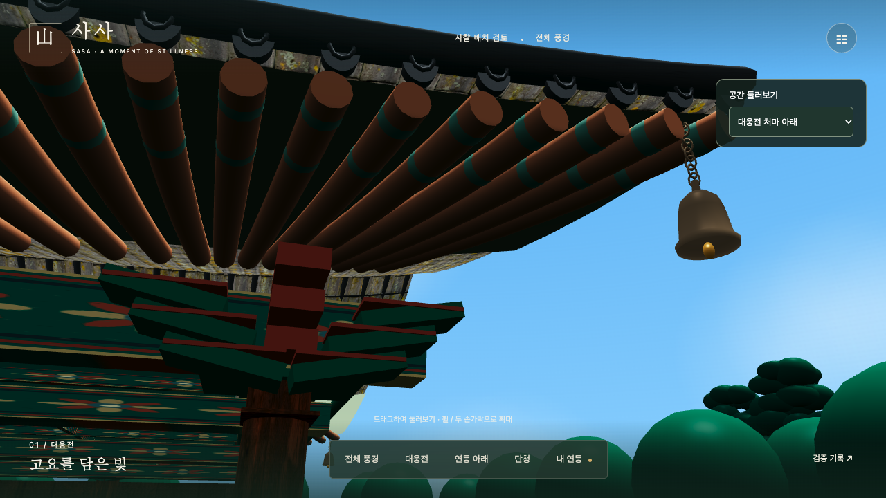
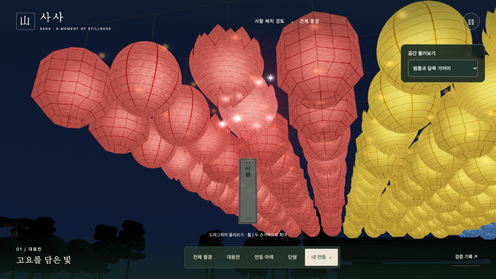
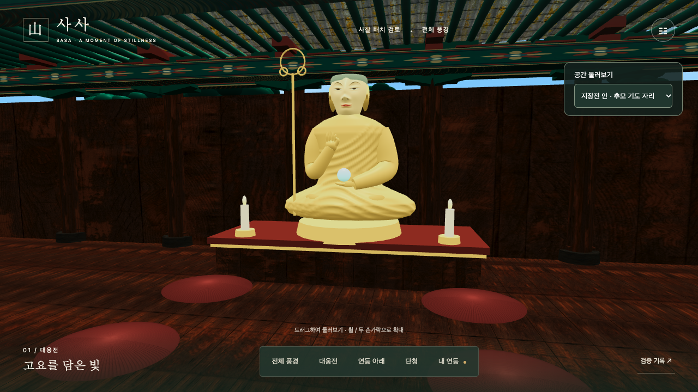
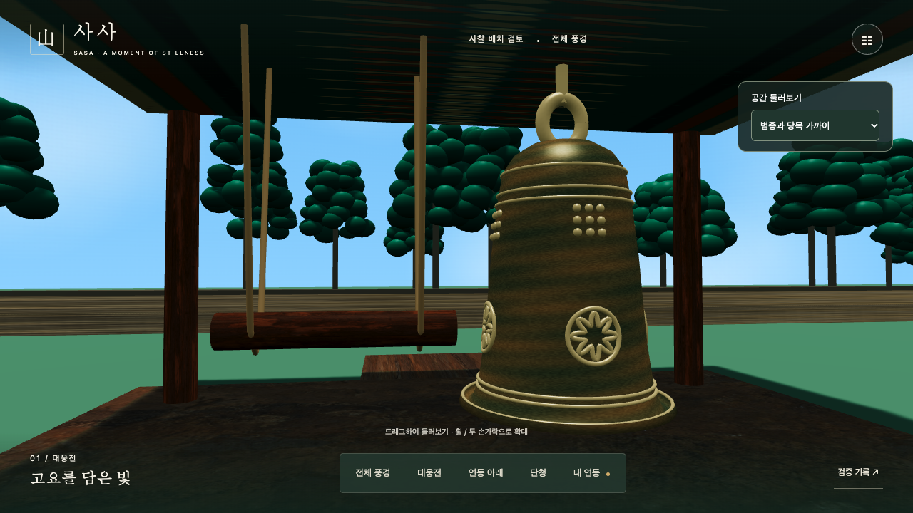

# M1 웹 통합 검수

현재 검수 대상은 사사 웹 3D 장면이다. 아래 이미지는 코드 커밋 9cb9175의 배포용 빌드에서 촬영했다. 현재 화면과 검수 조건을 함께 보고 시각 품질을 결정한다.

[13초 실제 탐방 영상](../evidence/m1-web/review-tour.webm) · [대표 화면 한눈에 보기](../evidence/m1-web/overview.jpg)

## 같은 검수본의 웹 결과

- 낮, 1280×720 고품질, 실제 연등 384개. 2분 예열 후 5분 동선 3회에서 평균 60.00 FPS, 하위 1% 53.60~53.63 FPS였다. [회차별 환경과 원본](I01-validation.md)
- 같은 웹 빌드, 야간 효과 켜짐, 내 연등 근접 시점의 12.6초 기록은 평균 60.00 FPS, 하위 1% 53.44 FPS였다. [야간 원본](../evidence/m1-web/night.json)
- 20Mbps·지연 80ms로 제한한 로컬 브라우저에서 새 방문 준비 화면 5.50초, 캐시 재방문 1.94초였다. 3개 소유 샘플의 순차 선택, 설정과 검증 기록의 키보드 초점 복귀를 확인했다. [로딩·접근성 원본](../evidence/m1-web/loading-access.json)
- 5·20·50m 낮·밤 거리별 화면을 기록했다. 같은 방향으로 물러나면 20m부터 건축물에 가려진다. 식별 시간 기준은 사용자 평가 전이다. [가림 비교](../evidence/m1-web/identification.jpg) · [시야를 높인 같은 거리 비교](../evidence/m1-web/open-sightlines.jpg). 가린 50m 시점에서 ‘내 연등’을 누르면 낮·밤 모두 동일 슬롯의 약 4m 시점으로 복귀했다. [카메라 좌표](../evidence/m1-web/sightlines.json)

## 장면

## 구현 이슈별 판정 근거

- #5 실제 웹 엔진 장면, 낮·밤 전환, 개별 소유 표시와 거리별 반짝임을 구현했다. 원본 측정과 승인 전 제안값은 [웹 검수 기준](I05-acceptance.md)에 기록한다.
- #6 현재 배치와 구역 계약의 건물 좌표를 일치시켰다. [좌표·동선](I02-layout.md)과 자동 검사에서 12개 구역, 네 가지 표시 밀도, 3개 소유 슬롯을 대조한다. 판매 용량은 미정이다.
- #7 만석, 동시 선택, 결제 잠금, 설치 복구 및 환불 경합을 [상태 계약](I03-state-contract.md)에 정의했다. 미확정 운영 정책별로 후속 이슈를 연결했다.
- #8 웹 성능 및 접근성 검수 증거를 #5와 같은 빌드에서 기록한다. 장시간·다인 식별 평가와 실제 운영망 로딩은 별도 결과가 필요하다.
- #9 [제작·감수 기록](I06-art-rights.md)에 직접 제작한 모델과 외부 재질을 구분했다. 참고 원본은 검수자가 로컬에서 선택한다. 최종 종교 감수 담당은 미지정이다.
- #10 [웹 우선 ADR](I07-platform-adr.md)에 익명 탐방, 구매 전 로그인, 서버 권리 복구, 앱 후속 판단을 정리했다. 제공자 선정은 실제 인증·결제 연동 전에 수행한다.
- #11 [서버 구조](I08-architecture.md)에 읽기 전용 샘플 API, 2인 세션 및 버전·재접속 책임을 기록했다. #72·#52는 M2 구현 이슈다.
- #12 Node 24와 잠금 파일 기준으로 테스트·타입 검사·빌드 후 로컬 검수본을 제공한다. GitHub Actions는 동일 검사를 수행하고 빌드 산출물을 보관한다.
- #13 이 문서에서 동일 빌드의 결과를 검토한다. 시각 품질은 사용자 일괄 검토, 종교 감수는 지정 담당의 판정, 성능은 실측으로 각각 기록한다.

## 한 번에 검토할 결정

1. 장면과 배치 — 연등의 색·거리별 식별, 기단·처마의 스케일, 대웅전 시야, 양쪽 전각과 남측 길을 위 이미지와 실제 화면에서 확인한다. 수정 희망 시 장소·시점으로 지정한다.
2. 공간·판매 — 검수 기준은 현재 384개 샘플과 대웅전 50석이다. 상품별 실제 판매 수량은 각 공간의 슬롯 검수 후 결정하는 안이다.
3. 승인 책임 — 화면 품질과 전체 배치는 서비스 책임자가 검토한다. 별도의 종교·건축 감수 담당, 운영 인프라 담당과 예산은 아직 지정되지 않았다.
4. 운영 정책 — 기한 내 설치 실패는 같은 슬롯에서 복구하고 환불 전환 기준은 실제 거래 기능 전에 확정하는 안이다. 예약 유효시간·기간 기산·만료 이력 공개·판매 지역도 해당 이슈의 선행 결정으로 남긴다.

## 후속 범위

저사양 휴대폰과 앱 검토는 후속 단계다. 종무소·인등전의 세부 제작은 M2 #23·#22에 속한다. 미확정 P03 예약 시간, P05 복구·환불, P06 만료 처리, 판매 수량, 계정·결제 제공자와 운영 인프라 예산은 해당 기능 착수 전 결정한다.

## 2026-11-07 최신본 낮·밤 동선 재검수

검수 커밋은 [66d0486](https://github.com/hjunnnS/meta-temple/commit/66d0486e42ecee881470e8ed523be8306b12b562)이다. 커밋에서 추출한 소스로 테스트 18개·타입 검사·배포 빌드를 통과했다. [GitHub 자동 검사](https://github.com/hjunnnS/meta-temple/actions/runs/42378260263)도 통과했다.

[낮·밤 동선 비교](../evidence/m1-66d0486/tour.jpg) · [실측 원본](../evidence/m1-66d0486/results.json)

- 1280×720 Chrome 156, 기본 고품질에서 낮과 밤 각각 진입 통로 → 천왕문 자동 통과 → 연등광장 → 대웅전 앞 → 법당 내부 → 내 연등 순서로 확인했다. 천왕문 이후에는 현재 제공하는 공간 선택과 시점 버튼을 사용했다.
- 낮에는 광장·대웅전 현판·불단을 확인했다. 밤에는 광장 연등과 불단은 보이지만, 천왕문 출구에서 광장까지 판석의 경계가 어둡고 대웅전 정면 현판 글자가 낮보다 읽기 어렵다. 야간 유도광 또는 현재 명암 수용 여부를 화면 검수에서 결정한다.
- 같은 로컬 주소에 내려받기 20 Mbps, 지연 80 ms를 적용했다. 탐색 시작부터 준비 완료까지 첫 방문 6.25초, 캐시 재방문 2.28초. 내 연등 근접 시점 약 12.6초씩 측정해 평균은 낮·밤 모두 60.00 FPS, 하위 1%는 낮 56.68·밤 56.54 FPS였다. 이번 순회는 최신본의 2분 예열 및 5분 3회 반복 시험과 별도로 기록한다.
- 검수 계기의 표시 수는 후보 384자리이며 새 신청용 빈자리 3개를 빼면 초기 연등 몸체는 381개다. 현재 미리보기의 판매 대상 5종 중 봉헌초를 정식 상품 계약에 반영하고, 검수 표기와 실제 수량을 맞추는 일이 남아 있다.
- 최종 시각 승인과 종교·건축 감수 담당 및 판정, 웹 검수 기준 및 미정 운영 정책의 후속 이관을 확인한 뒤 #13에서 M1 종료를 판정한다. M2 서버·2인 연결, 실제 결제, 모바일 대응은 후속 단계다.
